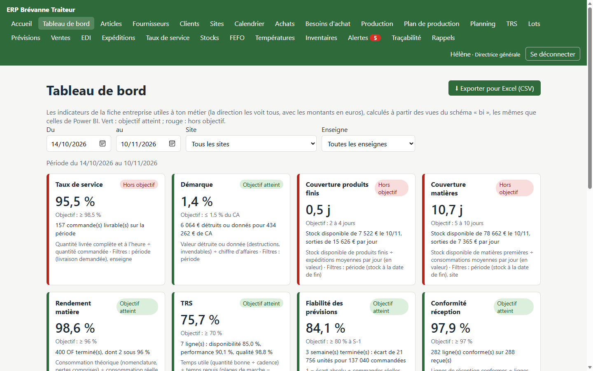
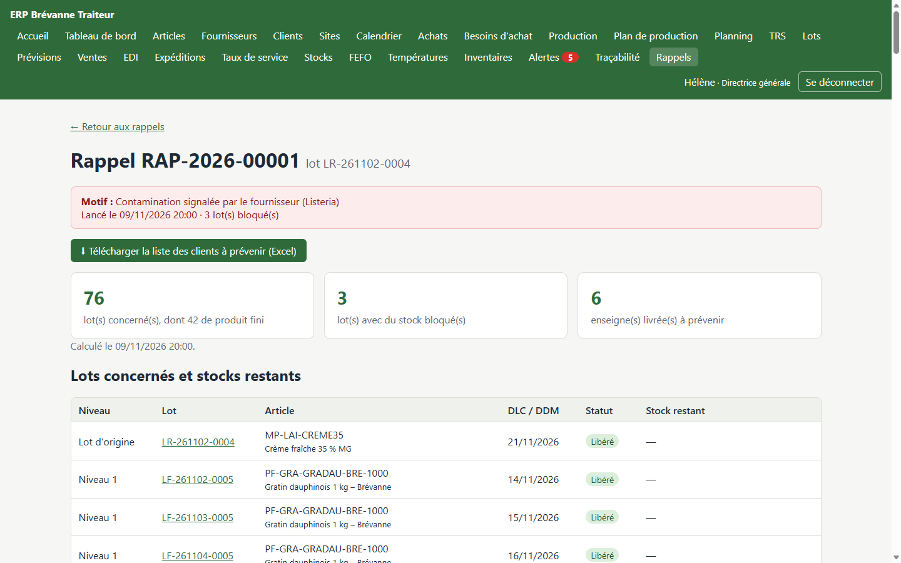
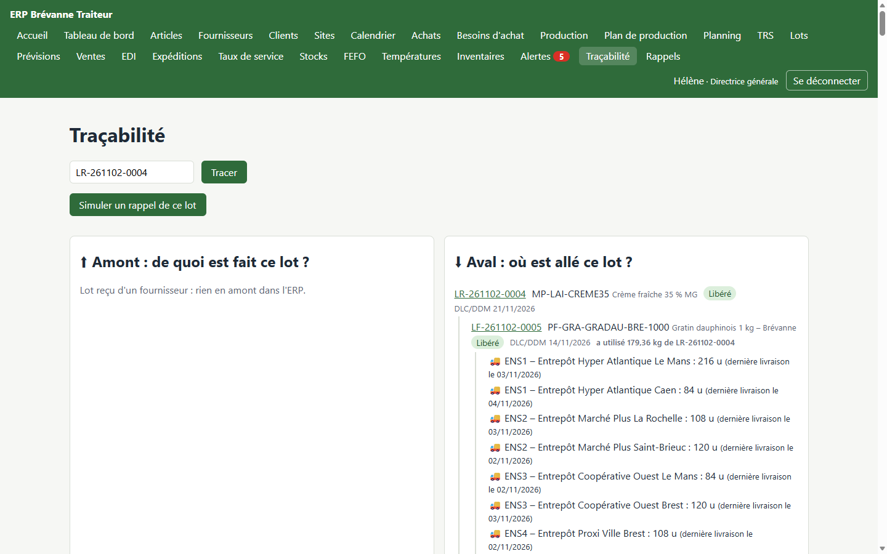
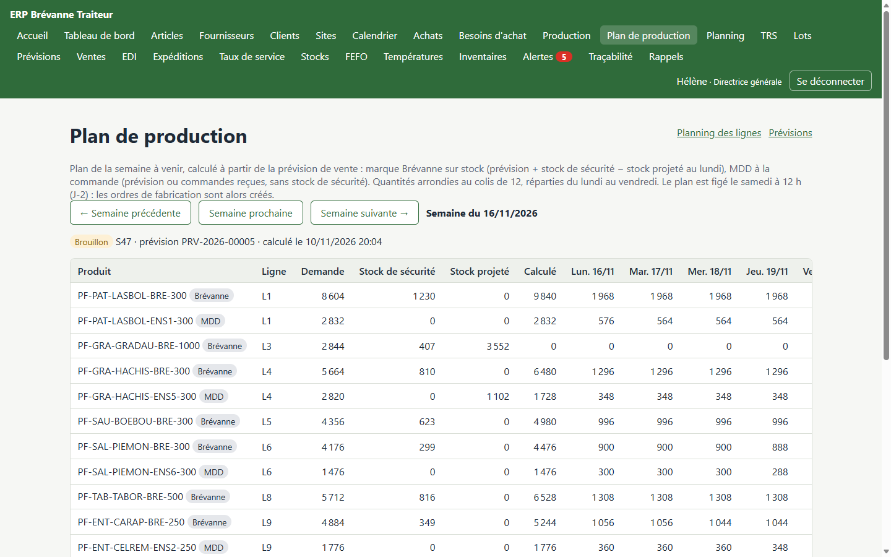
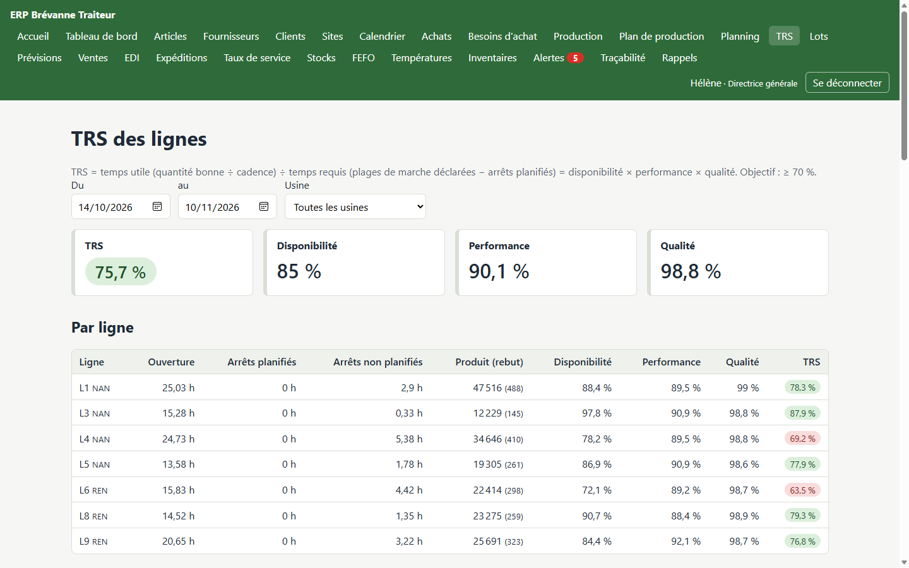

# ERP Brévanne Traiteur

ERP agroalimentaire complet pour **Brévanne Traiteur SAS**, une entreprise fictive de plats cuisinés frais : 520 salariés, 165 M€ de chiffre d'affaires, deux usines (plats chauds près de Nantes, traiteur froid près de Rennes), des ventes en grande distribution sous sa marque et en marque distributeur. Projet personnel, mené seul pour mettre en pratique le fonctionnement d'une supply chain agroalimentaire et ses contraintes ; le code a été écrit avec l'assistance de l'IA Claude Code.

Le contexte métier est décrit dans [`docs/fiche-entreprise.md`](docs/fiche-entreprise.md), les règles du projet dans [`CLAUDE.md`](CLAUDE.md) et les choix faits en cours de route dans [`docs/decisions.md`](docs/decisions.md).



**En vidéo (1 minute)** : le scénario du rappel produit, de l'alerte du fournisseur à la liste des enseignes à prévenir. La vidéo est fabriquée avec du code (Remotion), voir [`video/`](video/README.md).


## Ce que fait l'ERP

Tout le cycle d'un industriel du frais, de la commande de matières jusqu'à la livraison des enseignes :

- **Achats et réceptions** : commandes fournisseurs, contrôles à réception (température, durée de vie restante), lots créés en quarantaine.
- **Stocks par lot** : DLC / DDM, FEFO, statuts (libéré, bloqué, quarantaine, détruit), chaîne du froid, inventaires ; aucun stock ne change sans mouvement enregistré.
- **Production** : ordres de fabrication, consommations, rendements, arrêts de ligne et TRS.
- **Ventes** : commandes EDI simulées des enseignes, DLC minimale par enseigne, préparation FEFO, palettes SSCC, expédition, taux de service.
- **Prévisions et planification** : prévisions de vente à 8 semaines avec promotions, plan de production figé à J-2, calcul des besoins (MRP) et propositions d'achat.
- **Qualité** : traçabilité amont et aval en une requête, rappel produit, allergènes calculés à partir des recettes.
- **Pilotage** : 9 indicateurs par rôle, connexion Excel et Power BI en lecture seule.

Les **12 règles métier** (traçabilité totale, FEFO, DLC minimale client, statuts de lot…) sont appliquées par le serveur, pas seulement par l'écran, et couvertes par plus de 470 tests automatiques.

| Rappel d'un lot de crème contaminé | Traçabilité aval d'un lot |
| --- | --- |
|  |  |
| **Plan de production de la semaine** | **TRS des lignes** |
|  |  |

## Essayer la démo en 5 minutes

Une fois l'application lancée (voir [Premier lancement](#premier-lancement)), les données de démonstration rejouent 6 semaines d'activité. Pour en faire le tour :

1. Se connecter avec `helene.morvan` (directrice générale) et le mot de passe de démonstration : le **tableau de bord** montre les 9 indicateurs et leur évolution semaine par semaine.
2. Menu **Rappels** : la veille, la crèmerie a signalé un lot de crème contaminé. Le rappel liste les produits finis fabriqués avec, les stocks bloqués et les enseignes livrées, avec les quantités.
3. Cliquer sur le lot d'origine, puis **Voir la traçabilité de ce lot** : l'arbre va de la crème jusqu'aux entrepôts des enseignes.
4. Se déconnecter, puis se reconnecter avec `claire.lebihan` (qualité) ou `thomas.riou` (commercial) : chaque rôle ne voit que les écrans et les indicateurs de son métier.
5. **Plan de production**, **Prévisions**, **Taux de service** et **TRS** montrent la planification et ses résultats.

## Licence

Code source sous licence [**PolyForm Noncommercial 1.0.0**](LICENSE.md) : libre pour apprendre, étudier ou tester, à titre personnel ou dans un cadre d'enseignement. **L'utilisation commerciale**, notamment pour faire tourner une entreprise, n'est pas autorisée par cette licence : il faut une licence commerciale séparée, à demander à l'auteur (via son profil GitHub). Le texte de [`LICENSE.md`](LICENSE.md), en anglais, fait foi.

## Technologies

| Couche | Technologie | Version |
| --- | --- | --- |
| Base de données | PostgreSQL | 18 |
| Back-end | Python, Django, Django REST Framework | 3.14, 6.1, 3.18 |
| Historique et filtres | django-simple-history, django-filter | 3.13, 26.2 |
| Tâches de fond | Celery (worker + Beat), Redis | 5.6, 8 |
| Front-end | React, React Router, TypeScript, Vite | 19.3, 8.5, 6.0, 8.3 |
| Tests | pytest, Vitest | 9.2, 5.1 |
| Environnement | Docker Compose | — |

## Les conteneurs

| Service | Rôle | Adresse |
| --- | --- | --- |
| `db` | Base de données PostgreSQL | `localhost:5432` |
| `redis` | File d'attente des tâches de fond | — |
| `backend` | Django : API et administration | http://localhost:8000 |
| `worker` | Celery : exécute les tâches de fond | — |
| `beat` | Celery Beat : déclenche les tâches planifiées | — |
| `frontend` | Application React | http://localhost:5173 |

## Prérequis

- [Docker Desktop](https://www.docker.com/products/docker-desktop/) installé et **ouvert**.
- [Git](https://git-scm.com/).
- Python et Node.js sur le PC ne sont pas obligatoires : tout tourne dans Docker.

## Premier lancement

Toutes les commandes se tapent dans **PowerShell**. Compter environ 15 minutes la première fois (téléchargements et données de démonstration).

1. Télécharger le projet, puis entrer dans son dossier (ici dans `Documents`, n'importe quel dossier convient) :

   ```powershell
   cd $HOME\Documents
   ```

   ```powershell
   git clone https://github.com/hsgnexio-cmd/erp-agro.git
   ```

   ```powershell
   cd erp-agro
   ```

   Toutes les commandes suivantes se lancent depuis ce dossier `erp-agro`.

2. Créer le fichier `.env` à partir du modèle (à faire une seule fois) :

   ```powershell
   Copy-Item .env.example .env
   ```

3. Ouvrir `.env` (par exemple avec `notepad .env`) et remplacer les trois valeurs qui commencent par `change-moi` : `POSTGRES_PASSWORD`, `BI_DB_PASSWORD` et `DJANGO_SECRET_KEY`. Cette commande génère une chaîne aléatoire à copier-coller (la relancer pour chaque valeur) :

   ```powershell
   -join ((48..57) + (65..90) + (97..122) | Get-Random -Count 50 | ForEach-Object { [char]$_ })
   ```

   `DEMO_USERS_PASSWORD` (mot de passe des comptes de démonstration) peut rester tel quel.

4. Construire et lancer tous les conteneurs en arrière-plan (Docker Desktop doit être ouvert) :

   ```powershell
   docker compose up -d --build
   ```

   Le premier lancement prend quelques minutes. Attendre ensuite une trentaine de secondes que la base soit prête : `docker compose ps` doit afficher les 6 services `running`.

5. Créer le compte administrateur (Django demande un nom, un e-mail facultatif et un mot de passe ; rien ne s'affiche pendant la saisie du mot de passe, c'est normal) :

   ```powershell
   docker compose exec backend python manage.py createsuperuser
   ```

6. Charger les données de démonstration et l'équipe fictive (environ 6 minutes) :

   ```powershell
   docker compose exec backend python manage.py charger_donnees_demo
   ```

7. Ouvrir http://localhost:5173 et se connecter, par exemple avec `helene.morvan` (directrice générale) et le mot de passe `DEMO_USERS_PASSWORD` du fichier `.env`. Les autres comptes sont présentés plus bas (« L'équipe de démonstration »).

Si une commande répond qu'un port est déjà utilisé (5432, 8000 ou 5173), un autre logiciel l'occupe : pour la base, changer `POSTGRES_HOST_PORT` dans `.env` ; pour les autres, fermer le logiciel concerné.

## Utilisation au quotidien

Lancer le projet en arrière-plan (la fenêtre PowerShell reste libre) :

```powershell
docker compose up -d
```

Voir l'état des conteneurs :

```powershell
docker compose ps
```

Voir les logs du back-end en direct (`Ctrl + C` pour quitter) :

```powershell
docker compose logs -f backend
```

Arrêter le projet (les données de la base sont conservées) :

```powershell
docker compose down
```

Après un changement dans `requirements.txt` ou `package.json`, reconstruire les images :

```powershell
docker compose up -d --build --renew-anon-volumes
```

## Compte administrateur

Créé à l'étape 5 du premier lancement. Pour en créer un autre :

```powershell
docker compose exec backend python manage.py createsuperuser
```

Django demande un nom d'utilisateur, un e-mail (facultatif) et un mot de passe (rien ne s'affiche pendant la saisie, c'est normal).
Ensuite, ouvre http://localhost:8000/admin/ et connecte-toi.

## Données de démonstration

Remplir la base avec des données fictives cohérentes avec la fiche entreprise (sites, enseignes, fournisseurs, matières, recettes, nomenclatures, tarifs, commandes, réceptions et lots). La commande peut être relancée sans créer de doublons :

```powershell
docker compose exec backend python manage.py charger_donnees_demo
```

La commande rejoue aussi **6 semaines d'historique** sur le vrai calendrier (commandes et expéditions du lundi au samedi, production du lundi au vendredi, jours fériés), jour par jour : réceptions, fabrications, commandes des enseignes, expéditions, invendables, et la prévision de vente figée chaque lundi. Elle passe par les mêmes règles que l'application, avec quelques incidents volontaires (panne de ligne, transporteur en retard, fuite en cuisson, réceptions non conformes), une promotion ×2 d'une enseigne et, la veille, le **rappel d'un lot de crème** signalé contaminé par le fournisseur (le scénario de référence du projet). C'est ce qui alimente le tableau de bord. Ce chargement prend **environ 6 minutes** ; pour s'en passer :

```powershell
docker compose exec backend python manage.py charger_donnees_demo --sans-historique
```

## Rôles et utilisateurs

Les 7 rôles (`admin`, `direction`, `acheteur`, `magasinier`, `production`, `qualite`, `commercial`) sont des **groupes** Django, créés automatiquement par une migration. Leurs droits sont décrits dans [`docs/decisions.md`](docs/decisions.md). Chaque rôle **voit** les données utiles à son métier (principe du moindre privilège) et ne **modifie** que ce qui relève de son métier ; `admin` voit et fait tout.

### L'équipe de démonstration

`charger_donnees_demo` crée l'équipe fictive de Brévanne Traiteur (ou, seule : `docker compose exec backend python manage.py creer_comptes_demo`). Comme dans une vraie entreprise, plusieurs personnes peuvent avoir le même rôle. Tous ces comptes ont le **mot de passe de démonstration** `DEMO_USERS_PASSWORD` du fichier `.env` (comptes de test uniquement). Le compte administrateur, lui, se crée à part avec son propre mot de passe (voir plus haut).

| Identifiant | Personne | Fonction | Rôle |
| --- | --- | --- | --- |
| `helene.morvan` | Hélène Morvan | Directrice générale | direction |
| `pierre.kerjean` | Pierre Kerjean | Directeur administratif et financier | direction |
| `julien.legoff` | Julien Le Goff | Acheteur matières et emballages | acheteur |
| `sandrine.prigent` | Sandrine Prigent | Cheffe de quai, plateforme PFN | magasinier |
| `yann.tanguy` | Yann Tanguy | Magasinier, entrepôt matières MPE | magasinier |
| `marc.guillou` | Marc Guillou | Responsable de production, usine NAN | production |
| `anne.perrot` | Anne Perrot | Responsable de production, usine REN | production |
| `claire.lebihan` | Claire Le Bihan | Responsable qualité | qualite |
| `thomas.riou` | Thomas Riou | Commercial grands comptes | commercial |
| `lea.nedelec` | Léa Nédélec | Administration des ventes et prévisions | commercial |

### Qui voit quoi

Le menu de chacun n'affiche que ses écrans ; le serveur refuse aussi les données des autres (« Ton rôle ne donne pas accès à ces données »). Un magasinier voit les commandes fournisseurs qu'il réceptionne, mais **sans les prix d'achat** ; il voit les commandes clients qu'il prépare, mais **sans les prix de vente**.

| Domaine (écrans) | direction | acheteur | magasinier | production | qualite | commercial |
| --- | :-: | :-: | :-: | :-: | :-: | :-: |
| Référentiel (articles, fournisseurs, clients, sites, calendrier) | ✅ | ✅ | ✅ | ✅ | ✅ | ✅ |
| Lots, stocks, FEFO, températures, inventaires, alertes | ✅ | ✅ | ✅ | ✅ | ✅ | ✅ |
| Traçabilité, rappels, allergènes | ✅ | ✅ | ✅ | ✅ | ✅ | ✅ |
| Commandes fournisseurs, réceptions | ✅ | ✅ | ✅ | ✅ | ✅ | — |
| Prix d'achat (tarifs, montants des commandes fournisseurs) | ✅ | ✅ | — | — | — | — |
| Besoins d'achat (MRP) | ✅ | ✅ | — | ✅ | — | — |
| Production, planning, plan de production, TRS | ✅ | ✅ | — | ✅ | ✅ | — |
| Commandes clients, EDI, expéditions, taux de service | ✅ | — | ✅ | — | ✅ | ✅ |
| Prix de vente (tarifs, montants des commandes clients) | ✅ | — | — | — | — | ✅ |
| Prévisions de vente | ✅ | ✅ | — | ✅ | — | ✅ |
| Tableau de bord (indicateurs de son métier, export Excel) ; montants en euros | ✅ (tout, avec les euros) | ✅ | ✅ | ✅ | ✅ | ✅ |

### Qui peut faire quoi

| Rôle | Ce qu'il peut modifier |
| --- | --- |
| `direction` | Rien : tous les écrans en lecture, dont le tableau de bord et l'export Excel |
| `acheteur` | Besoins d'achat (MRP) et commandes fournisseurs : créer, envoyer, annuler ; tarifs d'achat ; fournisseurs |
| `magasinier` | Réceptions à quai, transferts, corrections, inventaires, relevés de température, alertes, préparation FEFO et expédition |
| `production` | Plan de production (calcul, ajustement, gel), ordres de fabrication et déclarations (plage de marche, rebuts), arrêts de ligne ; articles, recettes, nomenclatures, lignes |
| `qualite` | Libérer, bloquer, débloquer, détruire un lot ; invendables ; rappels produit ; allergènes ; relevés de température, alertes ; articles et nomenclatures |
| `commercial` | Commandes clients et EDI, tarifs de vente, enseignes et entrepôts ; prévisions de vente, promotions, corrections, versions figées |
| `admin` | Tout, y compris l'administration (référentiel, sites, fermetures du calendrier) |

Exemple de journée : `marc.guillou` déclare la fabrication du matin, `claire.lebihan` libère les lots, `sandrine.prigent` prépare et expédie les commandes, `helene.morvan` suit le taux de service sur le tableau de bord. Une action hors de son rôle est refusée avec un message clair.

### Créer d'autres utilisateurs

Administration → **Utilisateurs** → **Ajouter**. Puis, sur sa fiche :

- section **Permissions** → **Groupes** : choisir son rôle ;
- cocher **Statut équipe** s'il doit pouvoir utiliser l'administration (saisie du référentiel) ;
- section **Entreprise** : sa fonction (affichée en haut de l'application).

## Utiliser l'application

| Adresse | Contenu |
| --- | --- |
| http://localhost:5173 | Application React : tableau de bord, référentiel (articles, fournisseurs, clients, sites), commandes fournisseurs, réceptions, lots, état des stocks, FEFO, températures, inventaires, alertes, traçabilité, rappels, production, planning, ventes, EDI, préparation et expédition, taux de service |
| http://localhost:8000/admin/ | Administration : saisie du référentiel et des tarifs fournisseurs, historique des modifications |
| http://localhost:8000/api/referentiel/ | API du référentiel (liste des adresses disponibles, une fois connecté) |
| http://localhost:8000/api/achats/ | API des achats : tarifs, commandes, réceptions |
| http://localhost:8000/api/stocks/ | API des stocks : lots et mouvements |
| http://localhost:8000/api/pilotage/indicators/ | API des indicateurs du tableau de bord |

### Le tableau de bord

Menu **Tableau de bord** (tous les rôles) : chaque rôle voit les indicateurs de son métier (par exemple taux de service et fiabilité des prévisions pour le commercial) ; la direction voit les 9 indicateurs de la fiche entreprise, avec les montants en euros. Chaque indicateur est affiché avec son objectif (vert : atteint ; rouge : hors objectif) et leur évolution semaine par semaine.

| Indicateur | Calcul | Objectif |
| --- | --- | --- |
| Taux de service | Livré complet et à l'heure ÷ commandé | ≥ 98,5 % |
| Démarque | Valeur détruite ou donnée ÷ chiffre d'affaires | ≤ 1,5 % |
| Couverture produits finis | Stock disponible ÷ expéditions moyennes par jour (en valeur) | 2 à 4 jours |
| Couverture matières | Stock disponible ÷ consommations moyennes par jour (en valeur) | 5 à 10 jours |
| Rendement matière | Consommation théorique ÷ consommation réelle | ≥ 96 % |
| Conformité réception | Lignes conformes ÷ lignes reçues | ≥ 97 % |
| Délai de traçabilité | Durée d'un rappel « à blanc », mesurée à l'ouverture | ≤ 5 min |
| Fiabilité des prévisions | 1 − écart absolu ÷ quantités commandées, avec la prévision figée la semaine précédente (semaines terminées) | ≥ 80 % à S-1 |
| TRS | Temps utile ÷ temps requis des lignes = disponibilité × performance × qualité | ≥ 70 % |

Filtres : la période (28 derniers jours par défaut), le site (rendement, TRS, couverture matières) et l'enseigne (taux de service, fiabilité des prévisions). Les chiffres viennent des vues SQL du schéma `bi`, les mêmes que celles de Power BI (voir [`bi/README.md`](bi/README.md)). Le bouton **Exporter pour Excel (CSV)** télécharge les indicateurs et leur évolution par semaine, avec les filtres choisis.

### Le parcours d'achat

1. **L'acheteur** crée une commande (menu **Commandes** → **Nouvelle commande**) : il choisit un fournisseur audité, l'application propose ses articles avec le prix en vigueur. La commande est enregistrée en **brouillon**, puis **envoyée**.
2. **Le magasinier** ouvre la commande et clique sur **Réceptionner** : il saisit pour chaque ligne la quantité, le lot fournisseur, la DLC/DDM et la température.
3. L'application contrôle tout automatiquement et crée un **lot** par ligne : en **quarantaine** s'il est conforme, **bloqué** sinon (avec le motif). Chaque lot a son mouvement d'entrée en stock.

### La vie d'un lot

1. **La qualité** ouvre le lot (menu **Lots** → numéro du lot) et le **libère**, le **bloque** (motif obligatoire), le **débloque** ou le **détruit**.
2. **Le magasinier** le **transfère** : de la quarantaine vers la chambre froide, ou de l'entrepôt vers une usine. Seuls les emplacements à la bonne température sont proposés.
3. Le menu **Stocks** montre le stock par article et par site (libéré, quarantaine, bloqué) ; le menu **FEFO** indique quels lots utiliser en premier pour un besoin donné.

### La surveillance

- **Températures** : saisie des relevés des chambres froides. Un écart bloque automatiquement les lots présents et crée une alerte.
- **Inventaires** : ouverture (les emplacements sont gelés), comptage à l'aveugle, affichage des écarts, validation (les écarts deviennent des mouvements de stock).
- **Alertes** : chaque matin à 6 h, Celery vérifie la péremption proche, les DLC dépassées (lots bloqués) et les relevés manquants. Le compteur rouge du menu indique les alertes à traiter.

### La production

1. **La production** crée un ordre de fabrication (menu **Production** → **Nouvel OF**) : article, quantité, date, ligne compatible (proposée automatiquement) ou usine pour un semi-fini.
2. Elle **lance** l'OF, puis **déclare** ce qui a été produit : l'écran pré-remplit les lots à consommer dans l'ordre FEFO ; prendre un autre lot demande une justification.
3. Chaque déclaration crée un lot fabriqué (en quarantaine) relié aux lots consommés. À la **clôture**, l'OF affiche son rendement matière (objectif 96 %).
4. Le menu **Planning** montre la semaine ligne par ligne : charge en heures, surcharges, et ordre des allergènes à respecter.

### Les prévisions de vente

Menu **Prévisions** (consultation pour tous ; saisie par les rôles commercial et admin) :

- **La grille** donne la demande prévue (quantités commandées) par produit et par enseigne pour les semaines **S+1 à S+8**. Calcul : moyenne pondérée des 4 dernières semaines (40 %, 30 %, 20 %, 10 %), hors effet des promotions, arrondie au colis de 12. En jaune : une promotion ; en bleu : une correction manuelle.
- **Corriger** : cliquer sur une quantité, saisir la nouvelle quantité et un motif. La correction remplace le calcul ; elle n'est jamais modifiée (une nouvelle correction la remplace, « Revenir au calcul » rend la main au calcul).
- **Promotions** : enseigne, produit, semaine(s), coefficient jusqu'à ×3. Une promotion annoncée moins de 6 semaines avant est acceptée mais signalée.
- **Versions figées** : la prévision est figée chaque lundi à 5 h (Celery) et à la demande (« Figer une version »). Une version n'est jamais modifiée.
- **Fiabilité à S-1** : pour chaque semaine, la dernière version figée avant son lundi comparée aux quantités commandées.

### Le calendrier

Menu **Calendrier** : qui travaille quand (usines du lundi au vendredi, expéditions et livraisons du lundi au samedi, réceptions du lundi au vendredi), les 11 jours fériés de l'année (calculés automatiquement) et les **fermetures exceptionnelles** des sites, saisies dans l'administration (rôle admin).

Ce calendrier s'applique partout :

- **heure limite** : une commande reçue avant 11 h est livrable le prochain jour de livraison (le samedi compte, pas le dimanche ni les jours fériés) ; une livraison un dimanche ou un jour férié est refusée ;
- **taux de service** : « à l'heure » = expédiée au plus tard le jour d'expédition précédent la livraison (le samedi pour un lundi) ;
- **plan de production** et **planning** : les jours non ouvrés sont grisés, le plan n'y prévoit rien ;
- **achats** : les délais fournisseurs sont comptés en jours ouvrés de réception.

### Le TRS des lignes

- À la **déclaration de production** d'un produit fini, l'opérateur saisit la **plage de marche** de la ligne (début et fin, arrêts compris) et la **quantité rebutée** avec son motif (hors stock).
- Menu **TRS** : saisie des **arrêts** (ligne, début, fin, cause : panne, changement de série, manque matière ou personnel, réglage, maintenance préventive ou nettoyage planifiés). Un arrêt ne se modifie pas : il s'annule avec un motif.
- Le TRS (objectif ≥ 70 %) = disponibilité × performance × qualité, par ligne et au total, avec le **Pareto** des causes d'arrêt. Les arrêts planifiés sont retirés du temps requis.

### Le plan de production

Menu **Plan de production** (consultation pour tous ; calcul, ajustement et gel par les rôles production et admin) :

1. **Calculer le plan** de la semaine prochaine : pour chaque produit fini, demande (prévision figée ; pour un MDD, la plus grande valeur entre prévision et commandes reçues), stock de sécurité (marque Brévanne seulement, en jours de demande, réglable sur l'article), stock projeté au lundi. Le survol des chiffres donne le détail du calcul.
2. **Ajuster** : quantités par jour (du lundi au vendredi), ligne de conditionnement, ajout d'un produit. Le tableau **Charge des lignes** signale en rouge une journée au-delà de 15 h.
3. **Figer le plan** : un OF planifié est créé par produit et par jour. Sans action, le plan est figé automatiquement le **samedi à 12 h** (J-2). Ensuite, on modifie les OF ; l'écart avec le plan figé s'affiche dans le plan.

Figer tout de suite le plan de la semaine prochaine (comme le ferait la tâche du samedi) :

```powershell
docker compose exec backend python manage.py shell -c "from production.master_plan import freeze_next_week; print(freeze_next_week())"
```

### Les besoins d'achat (MRP)

Menu **Besoins d'achat** (consultation pour tous ; création des commandes par les rôles acheteur et admin) :

- La production prévue de la semaine en cours et des 8 suivantes (OF, plan de production, prévision de vente) est éclatée en matières et emballages, pertes comprises, puis comparée au stock disponible et aux commandes fournisseurs en cours (brouillons compris).
- Chaque manque devient une **proposition** chez le fournisseur audité : date de commande = besoin − délai du fournisseur (« en retard » en rouge si elle est passée), quantité relevée au minimum de commande.
- Par défaut, l'écran montre ce qu'il faut commander d'ici 7 jours (et les retards). Cliquer sur un article affiche son calcul semaine par semaine.
- L'acheteur coche des propositions, ajuste les quantités et clique sur **Créer les commandes brouillon** : une commande par fournisseur et par semaine de besoin, à vérifier puis envoyer depuis le menu **Achats**.

### Les ventes

- Chaque jour de semaine à 9 h 30, Celery simule les **commandes EDI** des 6 enseignes (menu **EDI**) : chaque message devient une commande client, ou est rejeté avec ses motifs (heure limite 11 h, produit MDD d'une autre enseigne, article inconnu…).
- Menu **Ventes** : les commandes clients, la saisie manuelle d'une commande et les tarifs de vente.

Simuler tout de suite les commandes EDI du jour :

```powershell
docker compose exec backend python manage.py simuler_edi
```

### La préparation et l'expédition

1. **Le magasinier** ouvre une commande reçue (menu **Ventes**) et clique sur **Préparer**. L'écran propose les lots de la plateforme PFN dans l'ordre FEFO, en écartant ceux dont la DLC est trop courte pour l'enseigne **à la date de livraison demandée** (ex. 70 % de la durée de vie). Prendre un autre lot demande une justification. Ce qui manque est une **rupture** : il n'y a pas de reliquat. La préparation crée un **bon de livraison** `BL-…`, sans encore toucher au stock.
2. Sur le bon de livraison (menu **Expéditions**), il saisit le **transporteur** et la **température au chargement**, puis clique sur **Expédier** : les mouvements de stock sont créés, la marchandise est répartie sur des **palettes de 720 unités** identifiées par un **SSCC** (étiquettes imprimables). Au-dessus de 4 °C, l'expédition est **refusée**, les lots sont bloqués et une alerte critique est créée.
3. Le menu **Taux de service** montre, par enseigne, la part livrée complète et à l'heure (expédiée au plus tard la veille de la livraison). Sous l'objectif de 98,5 %, le taux s'affiche en rouge, avec la liste des commandes à expliquer.
4. **La qualité** sort un produit fini bloqué ou périmé en **invendable** (fiche lot → **Sortir en invendable**) : don à une association, alimentation animale ou destruction.

### La traçabilité et le rappel produit

- **Traçabilité** : saisir un numéro de lot pour voir son **amont** (de quoi il est fait, à tous les niveaux) et son **aval** (ce qui a été fabriqué avec, jusqu'aux entrepôts clients livrés).
- **Simuler un rappel** depuis cet écran : lots concernés, stocks restants, enseignes livrées avec les quantités. Rien n'est modifié.
- **Lancer le rappel** (rôle qualité) : tous les lots concernés ayant du stock sont bloqués ; la liste des clients à prévenir se télécharge pour Excel (menu **Rappels**).
- Sur la fiche d'un produit fini ou d'un semi-fini, les **allergènes** sont calculés à partir de la nomenclature, avec leur origine.

Lancer la vérification des alertes tout de suite, sans attendre 6 h :

```powershell
docker compose exec backend python manage.py verifier_alertes
```

## Tests

Tests du back-end (pytest), répartis sur tous les cœurs du processeur (environ 2 min 30) :

```powershell
docker compose exec backend pytest
```

Pour lancer un seul fichier de tests, sur un seul processus (plus lisible en cas d'erreur) :

```powershell
docker compose exec backend pytest -n 0 ventes/tests/test_expedition.py
```

Vérification du style du code Python (ruff) :

```powershell
docker compose exec backend ruff check .
```

Tests du front-end (Vitest) :

```powershell
docker compose exec frontend npm test
```

Les mêmes tests sont lancés automatiquement par GitHub Actions à chaque push (voir [`.github/workflows/tests.yml`](.github/workflows/tests.yml)).

## Structure du dépôt

```
erp-agro/
├── backend/          # Django : config/ (réglages), comptes/ (utilisateurs, rôles, connexion),
│                     # referentiel/ (articles, nomenclatures…), une app par module
├── frontend/         # React + TypeScript (Vite)
├── docs/             # fiche entreprise, décisions (decisions.md), prochaine étape
├── data/             # scripts de données fictives (à venir)
├── bi/               # vues SQL « bi » (documentation), requêtes Power Query, mesures DAX
├── docker-compose.yml
└── .env.example      # modèle de configuration (copier en .env)
```

## Limites

- Projet **personnel** d'apprentissage : l'entreprise, les personnes et les données sont fictives.
- L'application tourne en **mode développement** (serveurs de développement de Django et de Vite, HTTP sans chiffrement, `DJANGO_DEBUG=True`). Elle est faite pour être lancée sur son propre PC, **pas pour être mise en ligne** telle quelle : il faudrait un serveur de production, HTTPS et les réglages de sécurité correspondants (`python manage.py check --deploy` les liste).
- Les échanges avec l'extérieur sont **simulés** : messages EDI des enseignes, pas d'envoi d'e-mails.

## Connexion Power BI / Excel

Excel et Power BI lisent les **vues du schéma `bi`** (décrites dans [`bi/README.md`](bi/README.md)), avec un utilisateur PostgreSQL **en lecture seule**, `powerbi`. Il ne voit aucune table de l'application et ne peut rien modifier. Les chiffres sont les mêmes que ceux du tableau de bord.

Pour un simple fichier Excel, sans connexion : bouton **Exporter pour Excel (CSV)** du tableau de bord.

### 1. Créer l'utilisateur `powerbi` (une seule fois)

Dans le fichier `.env`, ajouter (ou vérifier) ces deux lignes, avec un mot de passe d'au moins 12 caractères :

```
BI_DB_USER=powerbi
BI_DB_PASSWORD=un-long-mot-de-passe
```

Pour générer un mot de passe au hasard dans PowerShell :

```powershell
-join ((48..57) + (65..90) + (97..122) | Get-Random -Count 20 | ForEach-Object { [char]$_ })
```

Puis recharger la configuration et créer l'utilisateur (la commande est relançable, par exemple après un changement de mot de passe) :

```powershell
docker compose up -d
```

```powershell
docker compose exec backend python manage.py creer_utilisateur_bi
```

### 2. Se connecter depuis Excel

1. **Données** → **Obtenir des données** → **À partir d'une base de données** → **À partir d'une base de données PostgreSQL**.
2. Serveur : `localhost` (ou `localhost:5433` si `POSTGRES_HOST_PORT` a été changé) ; base de données : `erp_agro`. **OK**.
3. Onglet **Base de données** : utilisateur `powerbi`, mot de passe `BI_DB_PASSWORD` du fichier `.env`. **Se connecter**.
4. Dans le **Navigateur**, cocher **Sélectionner plusieurs éléments**, puis les vues `bi.fact_…` et `bi.dim_…` utiles (par exemple `bi.fact_service` et `bi.dim_customer`). **Charger** → **Charger dans…** → **Tableau croisé dynamique** et cocher **Ajouter ces données au modèle de données**.
5. Pour mettre à jour les chiffres : **Données** → **Actualiser tout**.

En cas de message d'erreur :

- **Chiffrement / SSL / certificat** : la base locale n'est pas chiffrée. **Données** → **Obtenir des données** → **Paramètres de la source de données** → choisir `localhost;erp_agro` → **Modifier les autorisations** → décocher **Chiffrer les connexions**.
- **« Vous devez d'abord installer un ou plusieurs composants supplémentaires »** : Excel a besoin du pilote PostgreSQL **Npgsql 4.0.17** (Power BI Desktop l'intègre déjà ; les versions 4.1 et plus ne fonctionnent pas avec Excel).
  1. Fermer Excel.
  2. Télécharger `Npgsql-4.0.17.msi` (1,5 Mo) sur la page officielle du projet : https://github.com/npgsql/npgsql/releases/tag/v4.0.17 (section *Assets*).
  3. Lancer le fichier ; à l'écran **Custom Setup**, cliquer sur **Npgsql GAC Installation** et choisir **Will be installed on local hard drive** (sinon Excel ne le trouve pas). Terminer l'installation.
  4. Rouvrir Excel et recommencer l'étape 1.

### 3. Ouvrir le rapport Power BI existant

Le rapport est dans `bi/powerbi/indicateurs.pbip` : double-clic pour l'ouvrir dans Power BI Desktop (Docker Desktop doit être lancé), puis **Actualiser**. Au premier lancement sur un PC, Power BI demande l'utilisateur `powerbi` et son mot de passe.

**Ajouter les prévisions (phase 9a)** au rapport : **Accueil** → **Obtenir des données** → **Requête vide** → **Éditeur avancé**, coller [`bi/power-query/fact_forecast_accuracy.pq`](bi/power-query/fact_forecast_accuracy.pq) et renommer la requête `fact_forecast_accuracy` (idem pour `fact_forecast.pq` si besoin). Créer ensuite les relations avec `dim_date`, `dim_customer` et `dim_article`, puis la mesure **Fiabilité prévisions** (voir [`bi/mesures-dax.md`](bi/mesures-dax.md)).

### 4. Construire un rapport Power BI depuis zéro

1. Installer **Power BI Desktop** (gratuit, depuis le Microsoft Store).
2. **Accueil** → **Obtenir des données** → **Requête vide** → **Éditeur avancé** : coller le contenu d'un fichier de [`bi/power-query/`](bi/power-query/), **Terminé**, puis renommer la requête comme le fichier (par exemple `fact_service`). Recommencer pour chaque fichier. Les types de colonnes (nombres, dates…) sont déjà réglés.
3. À la première requête, Power BI demande l'utilisateur et le mot de passe (onglet **Base de données**) ; même remarque que pour Excel s'il parle de chiffrement.
4. **Fermer et appliquer**. Si la « Détection des relations » tourne sans fin : **Fermer**, puis **Fichier** → **Options et paramètres** → **Options** → **Fichier actif** → **Chargement des données** → décocher **Détecter automatiquement les nouvelles relations**. Créer ensuite les relations et les mesures en suivant [`bi/mesures-dax.md`](bi/mesures-dax.md).
5. Vérifier : sur la même période, les cartes Power BI doivent donner les mêmes chiffres que le tableau de bord de l'application.
6. Enregistrer au format **projet Power BI** (**Fichier** → **Enregistrer sous** → type `*.pbip`) dans `bi/powerbi/`. Ce format est du texte, que Git sait suivre. Si le type `.pbip` n'apparaît pas : **Fichier** → **Options et paramètres** → **Options** → **Fonctionnalités en préversion** → cocher **Enregistrement de projet Power BI**.
